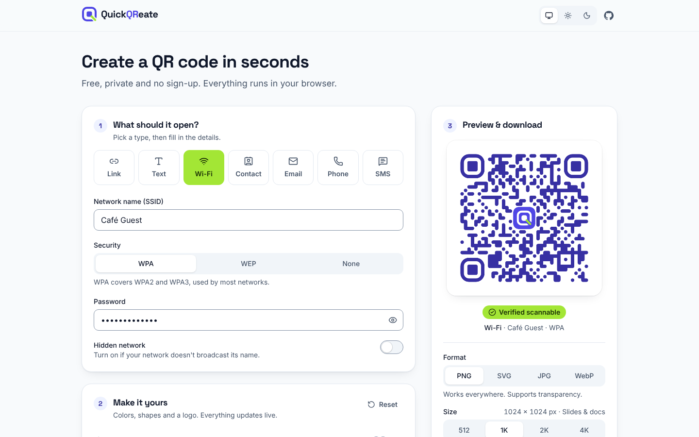
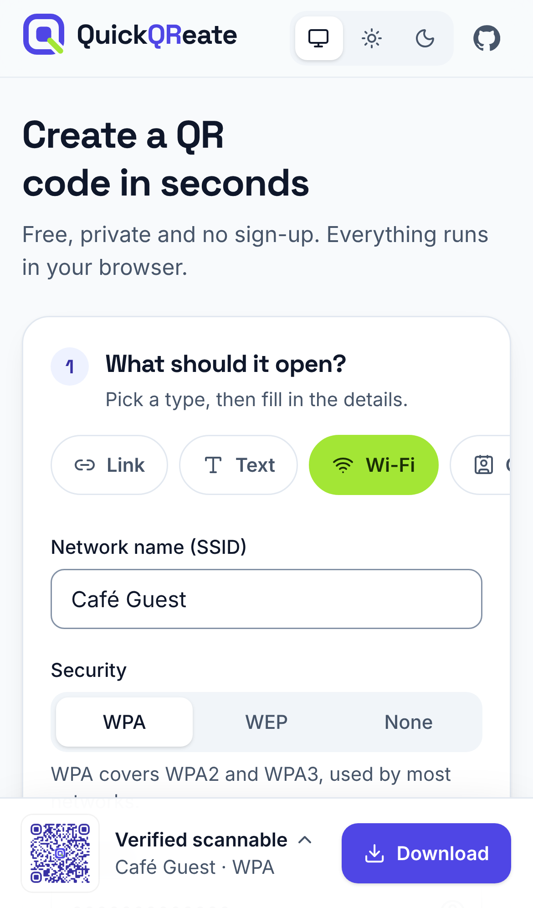
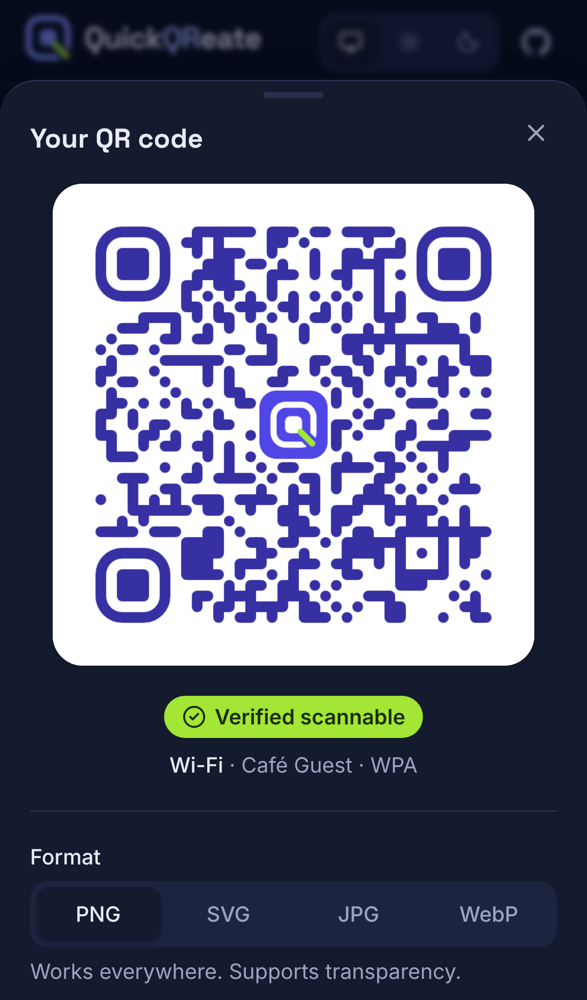

<p align="center">
  <picture>
    <source media="(prefers-color-scheme: dark)" srcset="public/brand/logo-lockup-dark.png" />
    
  </picture>
</p>

<p align="center">
  <strong>Create beautiful, scannable QR codes in seconds.</strong><br />
  Links, Wi-Fi, contacts, email, phone and SMS. Free, private and it runs entirely in your browser.
</p>

<p align="center">
  <a href="https://davidallmon.github.io/QuickQReate/"><strong>Open QuickQReate →</strong></a>
</p>

<p align="center">
  
  
  
  
  
</p>

<p align="center">
  <picture>
    <source media="(prefers-color-scheme: dark)" srcset="docs/screenshots/desktop-dark.png" />
    
  </picture>
</p>

<p align="center">
  
  &nbsp;
  
</p>

## Features

- **Seven QR types:** links, plain text, Wi-Fi (including hidden networks), contact cards (vCard), email, phone and SMS. Every type has labelled fields and friendly validation.
- **Live preview everywhere:** a sticky preview on tablet and desktop, and an always-visible thumbnail bar with a Download button on phones.
- **Scan check:** contrast, inverted colors, logo coverage and data density are checked as you edit. The rendered code is then decoded with a real QR reader, so "Verified scannable" means exactly that.
- **Make it yours:** scan-safe color presets, custom colors, transparent backgrounds, four pattern styles, three corner styles and a centered logo. Adding a logo raises error correction to High automatically.
- **Export:** PNG, SVG, JPG or WebP at 512 to 4096 px. Copy to clipboard or use the native share sheet where supported. Files get readable names like `quickqreate-wifi-cafe-guest.png`.
- **Remembers your style:** design and export settings are saved on your device. What you type, such as Wi-Fi passwords, never is.
- **Works offline:** install it as an app; it keeps working without a connection.
- **Accessible:** keyboard friendly, screen-reader labelled, WCAG AA contrast in light and dark themes, and it respects reduced motion.

## Privacy

QuickQReate has no backend, analytics or cookies. QR codes are generated in your browser and your content never leaves your device.

## Getting started

Requires Node.js 22 or newer.

```bash
git clone https://github.com/DavidAllmon/QuickQReate.git
cd QuickQReate
npm ci
npm run dev
```

Open [http://localhost:3000](http://localhost:3000).

### Scripts

| Command                | What it does                                                         |
| ---------------------- | -------------------------------------------------------------------- |
| `npm run dev`          | Start the development server                                         |
| `npm run build`        | Build the static site into `out/` and generate the service worker    |
| `npm start`            | Serve `out/` locally (honors `NEXT_PUBLIC_BASE_PATH`)                |
| `npm run lint`         | ESLint                                                               |
| `npm run typecheck`    | TypeScript                                                           |
| `npm test`             | Unit tests (Vitest)                                                  |
| `npm run test:e2e`     | End-to-end tests (Playwright) against the built site; run `build` first |
| `npm run format`       | Prettier                                                             |
| `npm run brand`        | Regenerate favicons, app icons, logos and the social image           |

## How it's built

```
app/                    Layout, metadata, theme tokens (globals.css), manifest, icons
components/
  brand/                Logo and the shared mark geometry used to generate assets
  layout/               Header, footer, theme toggle, providers
  ui/                   Buttons, fields, segmented controls, sheet, toast…
features/generator/
  content/              Type picker and one form per QR type
  style/                Colors, shape, logo and error correction
  preview/              Live preview, scan check, mobile bar and sheet
  export/               Download, copy and share
  state/                Reducer, defaults and saved settings
lib/
  qr/                   Encoders, validation, capacity, scan check, renderer adapter
  color/                WCAG contrast helpers
scripts/                Brand asset renderer, service worker generator, static server
e2e/                    Playwright tests that download codes and decode them with jsQR
```

- **QR logic is plain TypeScript** in `lib/qr`, fully unit tested, including spec-correct escaping for Wi-Fi and vCard payloads and UTF-8 support for any language or emoji.
- **Rendering** uses [qr-code-styling](https://github.com/kozakdenys/qr-code-styling) behind `lib/qr/renderer.ts`, the only file that knows about it.
- **Theme tokens** live in `app/globals.css`. `app/theme.test.ts` fails if any text color pair drops below WCAG AA contrast.

### Adding a QR type

1. Add the values type and ID in `lib/qr/types.ts`.
2. Write an encoder and validator (`lib/qr/encoders.ts`, `lib/qr/validators.ts`) with tests.
3. Register it in `lib/qr/qr-types.ts` (label, defaults, summary, filename).
4. Add an icon in `features/generator/content/registry.ts` and a form in `features/generator/content/forms/`, then wire it in `ContentForm.tsx`.

## Deployment

Pushes to `main` run lint, type checks, unit and end-to-end tests, then deploy the static export to GitHub Pages. The Pages build sets `NEXT_PUBLIC_BASE_PATH=/QuickQReate`, and every asset, icon, manifest and service worker URL respects it. The output in `out/` is plain static files and can be hosted anywhere.

[](https://vercel.com/new/clone?repository-url=https%3A%2F%2Fgithub.com%2FDavidAllmon%2FQuickQReate)

## Contributing

Issues and pull requests are welcome. Before opening a PR, run `npm run lint && npm run typecheck && npm test`, plus `npm run build && npm run test:e2e` for UI changes.

## License

MIT. See [LICENSE](LICENSE).

<p align="center">Made by <a href="https://github.com/DavidAllmon">David Allmon</a></p>
